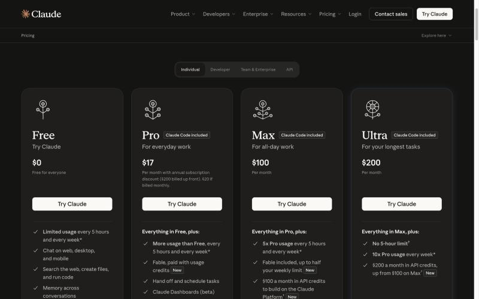
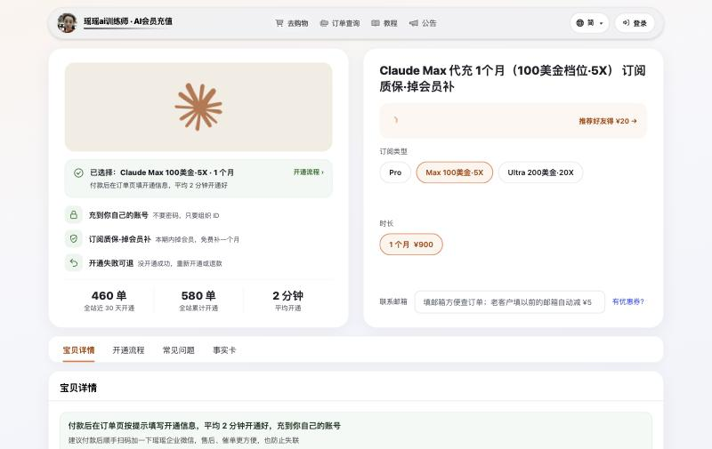

# Claude代充哪家好 2026：6 家 Pro/Max 价格·售后对比

> 2026-11-03 更新 · 瑶瑶ai训练师（kw.yaoyao.chat 店主）整理 · 文中商城链接为广告

**先说结论：** 逐家核对的 6 家里，Claude会员 Pro 一个月瑶瑶ai训练师的商城最便宜：[Claude代充 Pro ¥159](https://kw.yaoyao.chat/item/12?utm_source=github&utm_medium=readme&utm_campaign=claude-hp&utm_content=top)，200 美元档 ¥1,800 也最低；Max 5X ¥900，比 MuyuGPT 贵 ¥20。付款后填组织 ID，不要密码，平均 2 分钟到账，没开成重开或退款。下单填券码 **888888** 再减 ¥3。

- **价格区间**：Pro ¥159～¥299，Max 5X ¥880～¥999，200 美元档 ¥1,800～¥1,999；官方 20 / 100 / 200 美元，按月、不含税。
- **差别主要在售后**：交什么、多久到、掉订阅管不管、能不能开票，见表 B。6 家都没写明封号包赔。
- **谁不用买**：有能过结账的卡、确定用满一年的，官网年付 Pro 折合每月 17 美元更省；会员没到期想直接续或升档的，瑶瑶店里做不了（要换非会员账号）。
---

## 目录

1. [先认清三档：Pro、Max 5X、200 美元档](#一先认清三档promax-5x200-美元档)
2. [这 6 家怎么挑出来的](#二这-6-家怎么挑出来的)
3. [表 A：Claude代充价格对比](#三表-aclaude代充价格对比)
4. [表 B：交什么、多久到、怎么退](#四表-b交什么多久到怎么退)
5. [瑶瑶ai训练师占优和不占优的地方](#五瑶瑶ai训练师占优和不占优的地方)
6. [看表时最容易看错的 5 处](#六看表时最容易看错的-5-处)
7. [按情况选哪家](#七按情况选哪家)
8. [常见问题](#八常见问题)
9. [核对与来源](#九核对与来源)

---

## 一、先认清三档：Pro、Max 5X、200 美元档

很多人一上来就比价，结果买错档。先把三档分清：

| 档位 | 官方月费 | 用量（官方定价页原意） | 适合谁 |
|---|---|---|---|
| Pro | 20 美元；按年一次 200 美元，折合每月 17 | 比免费版多，每 5 小时和每周都有上限 | 日常写作、读文档、偶尔用 Claude Code |
| Max（同行叫 Max 5X） | 100 美元，只能按月 | 每 5 小时、每周都是 Pro 的 5 倍；每月另送 100 美元 API 额度 | 天天开 Claude Code、老撞 Pro 上限的人 |
| Ultra（同行多叫 Max 20X） | 200 美元，只能按月 | 每周是 Pro 的 10 倍；验证过的账号没有 5 小时上限；每月送 200 美元 API 额度 | 一整天都在跑长任务的重度开发 |

*图：Claude 官方定价页个人版四档（claude.com/pricing，2026-11-03 截图，搜索词：Claude会员 价格）。200 美元那档官方现在叫 Ultra，10-30 核对时还叫 Max 20x。*

两点要提前知道：

- **"20X" 这个叫法已经和官方对不上了。** 2026-11-03 官方定价页把 200 美元档叫 Ultra，写的是"每周 10 倍 Pro 用量"。不少代充页面还沿用旧名 Max 20X。比价时按"200 美元那一档"对齐就行，具体额度以你账号里显示的为准。
- **Pro 起就带 Claude Code**，不用另买。会员不含 API 余额，要调 API 得在官方开发者平台另外付费（Max 和 Ultra 每月送的 API 额度是另一回事，要按官方说明去领）。

第一次买，先开一个月 Pro。用一两周还老撞上限，再往上换。

## 二、这 6 家怎么挑出来的

挑的标准很简单：能把会员开到**你自己的** Claude 账号上（不是给成品号、不是共享号），价格写在公开页面上，能用支付宝或微信付人民币。

2026-11-03 在必应搜"claude代充平台"，前几名里卖 Claude 的网站，加上 10-29 ChatGPT 横评里已经核对过、也卖 Claude 的几家，一家家打开官网看。最后进表的是：

- **瑶瑶ai训练师**（kw.yaoyao.chat，本文作者的店）
- **MuyuGPT**（muyugpt.com）
- **PayAI**（payai.plus）
- **UpClaude**（upclaude.com，GETGPT Pro 官网首页的 Claude 入口跳到这里）
- **PayForChat / CCMaxPlan**（payforchat.com/claude 的 Pro 下单跳到 ccmaxplan.com）
- **ClaudeMax**（claudemax.shop）

看了但没进表的写在第九节。所有内容只来自对方公开页面，**没有下单、没有问客服**，所以表里没有"实测"两个字。

## 三、表 A：Claude代充价格对比

按 Pro 一个月从低到高排，价格都是"充到自己账号"的代充价，不是成品号价。

| 平台 | Pro 1 个月 | Max 5X 1 个月 | 200 美元档 1 个月 | 备注 |
|---|---|---|---|---|
| 瑶瑶ai训练师 | ¥159 | ¥900 | ¥1,800 | 三档同一个下单页；填券码 888888 再减 ¥3 |
| MuyuGPT | ¥178 | ¥880 | ¥1,880 | 三档都卖 |
| PayAI | ¥189 | 没有这档 | 没有这档 | 页面写"高风控商品，不含封号售后质保" |
| UpClaude | ¥189 | 页面写不支持 | 页面写不支持 | 只卖 Pro 和不带会员的普通号 |
| CCMaxPlan（PayForChat） | 无质保 ¥199 / 有质保 ¥299 | 页面没写价，微信咨询 | 页面没写价，微信咨询 | 两档区别见表 B |
| ClaudeMax | ¥249 | ¥999 | ¥1,999 | 另卖成品号（价格更高，本表不比） |
| *官方（参考）* | *$20，约 ¥134* | *$100，约 ¥672* | *$200，约 ¥1,343* | *不含税；人民币按 10-28 汇率中间价 6.7165 换算* |

- 核对时间 2026-11-03 00:15～00:35（北京时间）。各家随时会调价，**以对方下单页为准**。
- 瑶瑶ai训练师 Max 5X 的下单页：[Claude Max 5X 代充 ¥900](https://kw.yaoyao.chat/item/12?d=max5x&utm_source=github&utm_medium=readme&utm_campaign=claude-hp&utm_content=mid)，同一页还能切 Pro 和 Ultra。

*图：瑶瑶ai训练师商城 Claude 下单页，选了 Max 100美金·5X（kw.yaoyao.chat/item/12?d=max5x，2026-11-03 截图，搜索词：Claude代充 Max 5X）。*

## 四、表 B：交什么、多久到、怎么退

**B1：开通方式、到账、付款、客服**

| 平台 | 要交什么 | 页面写的到账时间 | 付款方式 | 客服时间 |
|---|---|---|---|---|
| 瑶瑶ai训练师 | 付款后在订单页填组织 ID，不要密码 | 平均 2 分钟（店铺自己的订单统计） | 支付宝、微信 | 全天 24 小时，企业微信 |
| MuyuGPT | 页面写不需要账号密码，只要下单邮箱或手机号 | 页面没写具体时间，写"以下单页提示为准" | 支付宝、微信 | 8:30–22:30 |
| PayAI | 付款拿卡密，自己登录 Claude 粘贴激活 | 支付成功即时发卡密，激活用时页面没写 | Claude 页写微信扫码 | QQ 客服 10:00–21:00 |
| UpClaude | 卡密 + Organization ID，不要密码 | 卡密即时发，激活通常 2–10 分钟 | 支付宝、微信 | 首页写 8:00–24:00，页底写 9:00–24:00 |
| CCMaxPlan | 联系邮箱 + Organization ID，不用注册 | 预计 1–3 小时 | 银行卡、微信、支付宝、Apple Pay | 页面只留了客服邮箱 |
| ClaudeMax | 用浏览器插件导出 claude.ai 的 Cookie（JSON），预检通过再付款；交付后自动清除，不要密码 | 通常 5–30 分钟 | 支付宝 | 8:00–23:00 |

**B2：失败、掉订阅、封号、已是会员、发票**

| 平台 | 开通失败 | 开通后掉订阅 | 封号 | 号上已有会员 | 发票 |
|---|---|---|---|---|---|
| 瑶瑶ai训练师 | 重新开通或退款 | 本期有效期内掉会员，补一个月 | 不在质保范围、不退款；协助按官方渠道申诉 | 不能叠加，要换一个非会员账号 | 可开，可对公 |
| MuyuGPT | 开通失败全额退款 | 文章页写"质保 30 天不掉订阅" | 页面写封号没有赔付 | 页面没写 | 可开，另加 6% 税费 |
| PayAI | 充值失败当天退款（按退款政策核验） | 页面写订阅取消等官方风控结果不属于未交付 | 不赔 | 只支持 Free 账号，Pro、Max 都不行 | 可开企业发票，付款后 7 天内申请 |
| UpClaude | 充值失败原路退；卡密激活后不退 | 页面没写掉订阅怎么补 | 风险用户自担，不售后不退款 | 必须是 Free，等到期再买 | 不开增值税发票，可导出收款凭证 |
| CCMaxPlan | 因平台原因没充成，全额退 | 有质保档符合条件时按剩余天数退；无质保档不退 | 无质保档自担；有质保档的具体条件页面没写清 | 页面让你先核对下单页的账号条件 | 页面没写 |
| ClaudeMax | 预检不过不收钱 | 页面没单独写 | 写明违反官方政策导致的封禁不退；因官方区域政策导致不可用的按未用天数退 | Pro 要 Free 账号；Max 要用过银行卡开会员的账号，银行卡订阅的可续费、升档；新号要等 3–15 天才能充 200 美元档 | 个人单只有支付宝账单，企业走对公通道开票 |

"页面没写"只代表这次在公开页面上没找到，不代表对方没有这项服务，下单前可以问对方客服。

## 五、瑶瑶ai训练师占优和不占优的地方

文里只有这一家放了购买链接，所以它的长处和短处集中写清楚。

**占优的地方**

- **价格**：Pro ¥159、200 美元档 ¥1,800，都是本表最低；填券码 888888 分别实付 ¥156、¥1,797。
- **到账和客服**：平均 2 分钟到账，全天 24 小时，全程在网页上完成，不用加微信等人。
- **要交的东西少**：只填组织 ID，不要密码，也不要整段 Cookie。
- **售后写得具体**：没开成重开或退款；本期有效期内掉会员，凭订单号和截图再补一个月，补到同一个账号。
- **能开发票、能对公**，没写另收费用。
- **成交和评价可查**：全站近 30 天开通 460 单（全部商品合计，截至 2026-11-03）；商城有 61 条买家评价，平均 4.9 星，只有开通成功的订单能评，差评不删。

**不占优的地方（照实写）**

- **Max 5X 不是最便宜**：¥900，比 MuyuGPT 的 ¥880 贵 ¥20。
- **已经是会员的号充不了**：号上 Pro 或 Max 还没到期，不能在上面续或升档，只能等到期或换一个非会员账号。ClaudeMax 写了银行卡订阅的账号能续、能升，这一点它更灵活。
- **封号不赔**：和表里其他几家一样，账号被封不在质保范围、不退款，只协助按官方渠道申诉。
- **代充不是官方渠道**：账号风控由 Anthropic 决定，哪一家都控制不了。

## 六、看表时最容易看错的 5 处

1. **"20X"到底是多少。** 官方现在的 200 美元档叫 Ultra，写的是每周 10 倍 Pro 用量、验证过的账号没有 5 小时上限。同行页面上的"Max 20X"是旧叫法，别拿倍数去比，按"200 美元那一档"对齐。
2. **到账时间口径不一样。** 瑶瑶ai训练师的"平均 2 分钟"是它自己的订单统计；同行写的是"通常""预计"。CCMaxPlan 写 1–3 小时，急用的要看清。
3. **"卡密即时发"不等于"会员已开通"。** PayAI、UpClaude 都是先发卡密，你再自己去激活。卡密激活前账号不是 Free 的话会充不进去，UpClaude 和 PayAI 都写了这种情况损失自负。
4. **要交的东西敏感程度不同。** 组织 ID 只是一串账号编号；整段 Cookie 里有登录状态，交出去等于让对方能用你的登录。ClaudeMax 写了交付后自动清除，愿不愿意交，你自己判断。不管哪家，要密码或验证码的直接换。
5. **"有质保"三个字要看细则。** 有的是补一个月，有的是按剩余天数退钱，有的另收一百块才给质保。看 B2 表"掉订阅"和"封号"两列，比看宣传语靠谱。

## 七、按情况选哪家

- **只想要 Pro、要便宜**：瑶瑶ai训练师 ¥159，填 888888 实付 ¥156；MuyuGPT ¥178 第二。
- **要 Max 5X**：MuyuGPT ¥880 最低；瑶瑶ai训练师 ¥900 第二；ClaudeMax ¥999。
- **要 200 美元档（Ultra）**：瑶瑶ai训练师 [Claude 200美元档 Ultra ¥1,800](https://kw.yaoyao.chat/item/12?d=max20x&utm_source=github&utm_medium=readme&utm_campaign=claude-hp&utm_content=mid2) 最低；MuyuGPT ¥1,880；ClaudeMax ¥1,999。新注册的号在 ClaudeMax 要等 3–15 天才能充这一档。
- **号上会员没到期、想直接续或升档**：ClaudeMax（银行卡订阅的账号）。其余几家都要求 Free 账号。
- **要企业发票报销**：PayAI（7 天内自助申请）；瑶瑶ai训练师（可开、可对公）；MuyuGPT（另加 6%）。UpClaude 不开增值税发票。
- **想多花钱换个按天退款的质保**：CCMaxPlan 有质保档 ¥299。
- **半夜下单也想有人管**：瑶瑶ai训练师全天 24 小时；UpClaude 到 24:00；ClaudeMax 到 23:00。

开通流程本身这里不展开，下单页都有提示；每一步怎么做、卡住怎么排查，会写在另一篇 Claude 开通教程里。

## 八、常见问题

**1. Claude代充平台哪家靠谱？**
没有一家适合所有人。只比价看表 A；在意售后看 B2 的"开通失败、掉订阅、封号"三列；在意隐私看 B1 的"要交什么"。不管选谁，先买一个月 Pro 试，比看评价更靠谱。

**2. Claude会员多少钱？一个月代充比官方贵多少？**
官方 Pro 20 美元、Max 100 美元、Ultra 200 美元，都不含税。本表代充价 Pro ¥159～¥299、Max 5X ¥880～¥999、200 美元档 ¥1,800～¥1,999（2026-11-03 核对）。按 10-28 汇率中间价算，官方 Pro 约 ¥134，代充多出来的是换汇、付款渠道和售后成本。

**3. Claude Pro代充要给密码吗？组织 ID 是什么？**
不用给密码。组织 ID（Organization ID）在 claude.ai 设置的账号页里，是一串账号编号，瑶瑶ai训练师、UpClaude、CCMaxPlan 都只要这个。ClaudeMax 要导出整段 Cookie，敏感程度高得多。谁要密码或邮箱验证码，直接换一家。

**4. Claude Max代充选 5X 还是 200 美元档？**
先看你一周会不会撞两次以上 Max 5X 的上限。不会就留在 5X；天天开 Claude Code 跑长任务、5 小时上限老打断你的，再上 200 美元档（官方现名 Ultra，验证过的账号没有 5 小时上限）。

**5. Claude 已经是 Pro 了，还没到期能续费或升级吗？**
看平台。瑶瑶ai训练师、PayAI、UpClaude 都要求非会员（Free）账号，要么等到期，要么换一个免费账号。ClaudeMax 写了银行卡订阅的 Pro、Max 能续费、升档，App Store 或 Google Play 订阅没到期的不行。

**6. Claude代充会封号吗？封了退钱吗？**
没人能保证。本表 6 家没有一家写明封号包赔；ClaudeMax 写了"因官方区域政策导致不可用的按未用天数退"，但违反政策导致的封禁不退。一人一号、不共享、别频繁换网络，是各家页面都提到的做法。

**7. Claude代充能开发票吗？**
PayAI 可开企业发票；瑶瑶ai训练师可开、可对公；MuyuGPT 可开但另加 6% 税费；UpClaude 只能导出收款凭证；ClaudeMax 个人单只有支付宝账单，企业要走对公通道。

**8. Claude 和 ChatGPT 该先开哪个？**
写长文、读大文件、用 Claude Code 写代码的，开 Claude；什么都想试一下、或者要用 Codex 的，ChatGPT Plus 更便宜。ChatGPT 那边各家怎么比，看同作者的 [ChatGPT代充平台横评](https://github.com/yaoyao-chat/daichong)；怎么给 ChatGPT 充值，看 [ChatGPT充值教程](https://github.com/yaoyao-chat/chongzhi)。

## 九、核对与来源

**怎么比的**

- 2026-11-03 00:15～00:35（北京时间）逐家打开官网的 Claude 页、常见问题、退款或服务条款核对；价格是网页加载后才显示的，用浏览器读。没有下单，没有联系客服。
- 只写对方页面上写着的；没找到的写"页面没写"。
- 瑶瑶ai训练师的价格、到账、单量、评价，来自其商城事实卡（2026-11-03 00:14 从数据库导出）。
- 看了没进表的：GETGPT Pro 自己的 Claude 页（getgpt.pro/claude）列了 Pro、Max 5x、Max 20x，但没标价格，开通按钮都指向联系客服；EZSub 的 Claude 页价格要加载后才显示，这次没核到。都按"查不到价格不列"处理。
- 发现有误，联系瑶瑶企业微信反馈，核对后更正，并写进下面的复测记录。

**来源（同行均不带推广码）**

- 官方价格：Claude 定价页 https://claude.com/pricing （2026-11-03）
- 官方政策：Anthropic Usage Policy https://www.anthropic.com/legal/aup （2026-11-12 生效版，2026-11-03 查看）
- MuyuGPT：muyugpt.com/claude 、muyugpt.com/blog/claude-recharge-pro-max 、muyugpt.com/legal
- PayAI：payai.plus/claude 、payai.plus/refund-policy
- UpClaude：upclaude.com （入口见 getgpt.pro ）
- PayForChat / CCMaxPlan：payforchat.com/claude 、ccmaxplan.com
- ClaudeMax：claudemax.shop/subscribe 、claudemax.shop/faq
- 汇率：中国外汇交易中心人民币汇率中间价（2026-10-28，1 美元 = 6.7165 元）https://www.chinamoney.com.cn/chinese/bkccpr/
- 瑶瑶ai训练师：商城下单页和评价页 https://kw.yaoyao.chat/pingjia

**复测记录**

- 2026-11-03：首次整理，核对 6 家 Claude 代充的价格、开通方式、售后和发票规则。

**相关教程**

- [ChatGPT代充平台横评：6 家价格、到账、售后对比](https://github.com/yaoyao-chat/daichong)
- [GPT代充 / GPT充值：ChatGPT Plus 国内充值指南](https://github.com/haiwaihuyonghui-rgb/gpt-chongzhi)
- [ChatGPT Pro价格：100/200/500 美金三档区别](https://github.com/yaoyao-chat/gpt-pro)
- [ChatGPT / Claude / Grok 充值代充教程合集](https://github.com/yaoyao-chat/yaoyao-chat.github.io)
- Claude 开通的完整步骤（组织 ID 怎么找、已是会员怎么办）另有一篇专门讲，发布后补链接。

## 关于作者与声明

本文由瑶瑶ai训练师整理，作者 2023 年 10 月开始做 AI 科普，kw.yaoyao.chat 是作者自己经营的商城，文中指向它的链接都是广告。代充不是官方渠道，作者和 Anthropic 没有隶属或授权关系；Claude、Anthropic 是 Anthropic 的商标，其他平台名称归各自所有者。本文只做信息对比，价格和规则以各平台页面为准。任何时候都不要把账号密码和验证码给任何人，包括自称瑶瑶客服的人；客服只有企业微信 `kw.yaoyao.chat/wecom`。

想直接开的：[Claude会员 Pro ¥159 / Max 5X ¥900 / Ultra ¥1,800](https://kw.yaoyao.chat/item/12?utm_source=github&utm_medium=readme&utm_campaign=claude-hp&utm_content=end)，三档同一页切换，付款后平均 2 分钟到账，填券码 888888 再减 ¥3。
